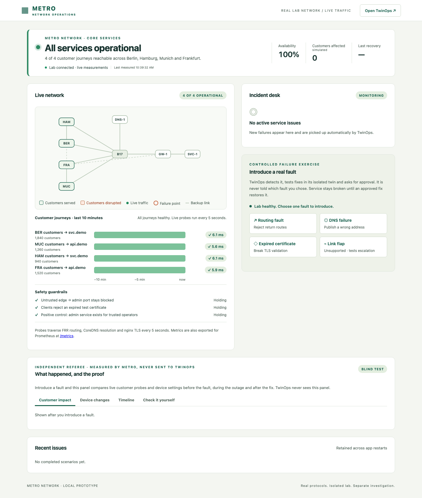
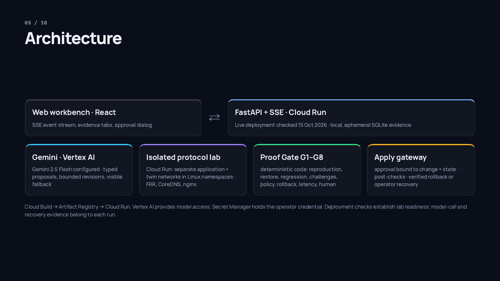

# TwinOps: AI that tests its fix before you approve it

**Project:** TwinOps  
**Theme:** Future of Work & Enterprise Productivity  
**Prepared:** 16 October 2026\
**Tagline:** AI that tests and challenges a fix before a human approves it.

## What I Built

TwinOps helps network engineers investigate incidents and review repairs with evidence. It reads service symptoms and configuration, reproduces the affected network slice in an isolated digital twin, and tests competing fixes. A challenge stage checks the strongest proposal for regressions such as exposed management access, broken IPv6 routes or stale DNS caches. Deterministic gates evaluate the results. A human reviews a Proof Pack and approves the exact tested change before the apply gateway can modify the application lab. The prototype is deployed on Google Cloud Run, with Gemini 2.5 Flash configured through Vertex AI and real FRR, CoreDNS and nginx protocol networks.

The idea is simple: an AI can be wrong while exploring a repair, but its proposal needs evidence before it can become an approved change.

## Demo

| Material | Location |
|---|---|
| Deployed prototype | [TwinOps workbench](https://twinops-live-705406130795.europe-west1.run.app/workbench) |
| Connected application | [Metro Network](https://twinops-live-705406130795.europe-west1.run.app/metro/) |
| Product overview | [TwinOps overview](https://twinops-live-705406130795.europe-west1.run.app/) |
| Presentation | [PDF deck](TwinOps_Deck.pdf) and [interactive deck](https://twinops-live-705406130795.europe-west1.run.app/deck) |
| Source repository | [TwinOps on GitHub](https://github.com/prabhakarcs786/twinops) - owner will make public as a final step |
| Public demo video | [Watch TwinOps on YouTube](https://youtu.be/wyze5IWUEC0) — 2:58 end-to-end walkthrough of the deployed application |
| Judge instructions | [Judge guide](JUDGE_GUIDE.md) |

Competition references: [published requirements](https://aibuildercup.com/themes.html) and [submission FAQ](https://aibuildercup.com/Faqs.html).

*Captured from the deployed Metro app on 15 October 2026 during a read-only review. This shows a healthy lab before an exercise; it is not evidence of a completed Gemini repair. Customer counts are simulated.*

### A Short Judge Walkthrough

1. Open Metro and inspect current journeys, measurement time and safety guardrails.
2. Open TwinOps and check the connected application and planner in **Runtime details**.
3. With the host's approval access ready, introduce a supported fault and follow the automatically detected investigation.
4. Inspect **AI trace**, candidate tests, challenges and **Decision review**. Separate actual model calls from any runbook fallbacks.
5. Have the authorized host approve the exact tested change, then compare fresh recovery probes in both apps and export the Proof Pack.
6. After the exercise finishes, check that the unsupported link-flap case stops or escalates without guessing a repair.

Coordinate the shared-lab session with the host; a visitor without approval access should use the read-only inspection. The [judge guide](JUDGE_GUIDE.md) explains access, reset and recovery behavior. The [YouTube showcase](https://youtu.be/wyze5IWUEC0) and [sanitized run record](evidence/recorded-demo.json) preserve the completed routing demonstration.

## Why This Problem Matters

Network incidents force on-call engineers to correlate alarms, recent changes, routing, DNS, certificates and customer reachability across tools. Under outage pressure, a repair that removes the symptom can create a second problem: disabling an edge filter may restore service while exposing an administrative endpoint; rolling back a configuration may discard an IPv6 hotfix.

An AI-generated explanation alone does not establish that the proposed change restores service, preserves unaffected journeys or can be rolled back. Change approvers often have to repeat the investigation to reach a decision.

TwinOps serves network operations engineers, SREs and change approvers. Its enterprise-productivity goal is to turn investigation and change review into a shared, inspectable workflow: observed cause, tested alternatives, explicit limits, a reviewable diff and a human decision.

## How It Works

1. **Observe:** Metro Network measures customer journeys and reports failures. TwinOps polls its authenticated connector every five seconds; the selected exercise fault is not sent to the planner.
2. **Diagnose:** the planner ranks hypotheses using captured observations and bounded read-only diagnostics.
3. **Reproduce:** TwinOps reconstructs the affected slice in its separate twin and checks whether the failure reproduces with adequate coverage.
4. **Experiment:** typed candidate changes run against fresh copies of the faulty state. Restoration, regression, negative controls and rollback are checked.
5. **Challenge:** mandatory checks and planner-selected additional checks probe weaknesses. Failed results can guide up to two revisions, each fully retested.
6. **Prove:** seven automated gates evaluate reproduction, recovery, regressions, challenges, policy, rollback and soft performance/session checks. Missing evidence can block a candidate; warnings remain visible.
7. **Approve:** the human reviews the Proof Pack. The eighth gate binds approval to the tested change and target-state hashes.
8. **Apply and verify:** the gateway rechecks authorization, evidence age and target drift, applies the change and observes recovery. Failure triggers a rollback attempt and verification; unverifiable recovery requires an operator.

The application lab and twin are separate. Every scenario uses synthetic topology and incidents; the lab has no access to a carrier production network or real customer data.

## How I Used Google Cloud and Gemini

The hosted configuration selects **Gemini 2.5 Flash through Vertex AI**, accessed using the Google Gen AI SDK and service-account credentials. The planner integration supports evidence-citing hypotheses, catalogue-based repair proposals, additional challenge selection, revisions based on failed probes, approver briefings and questions about an investigation.

The model cannot run a shell command, alter the tests, calculate its own authoritative verdict or approve its own action. Structured output is checked against schemas and an allow-listed action catalogue. Instruction-like text in device logs is treated as untrusted data. Fixed policy checks and mandatory challenges remain in code.

AI trace records distinguish model requests, rejected output and runbook fallbacks. The [recorded hosted repair](evidence/recorded-demo.json) retains ten actual Vertex/Gemini calls, zero fallbacks and zero discarded validation items. The selected repair was directly model-proposed. A controlled model-versus-runbook benchmark remains separate work. The overview's animations and browser evaluation intentionally use the deterministic engine.

## Architecture

*Architecture slide from the updated submission deck, rendered on 15 October 2026. It describes the implementation; the deployment and execution evidence is scoped below.*

| Component | Responsibility |
|---|---|
| React workbench and Metro web UI | Present service health, investigation progress, candidate evidence and human decisions |
| FastAPI and server-sent events | Orchestrate investigations and stream evidence to the workbench |
| Cloud Run, second-generation environment | Run the connected prototype in a single container with two isolated Linux namespace networks |
| Vertex AI and Gemini | Provide bounded reasoning through structured model requests |
| FRR, CoreDNS and nginx | Exercise real BGP/routing, DNS, IPv4/IPv6 and TLS behavior in the application lab and twin |
| Proof Gate and apply gateway | Evaluate evidence and enforce the authorized write boundary |
| SQLite | Journal incidents, events, decisions and review trials on the instance's local disk |
| Cloud Build and Artifact Registry | Build and store the deployment image |
| Secret Manager | Supply the operator approval credential |

The deployed service is in `europe-west1`. Cloud Run uses Linux network namespaces instead of privileged Docker; local development uses Containerlab. See the deck's architecture diagram, [deployment script](../deploy/cloudrun-lab.sh), [Cloud Run entrypoint](../backend/twinops/cloudrun.py) and [technical guide](TECHNICAL_GUIDE.md#architecture).

## What Makes It Different

TwinOps makes a proposal contestable before it can become a change. It compares alternatives, preserves rejected candidates, attacks a promising fix and requires fresh tests after a revision. A successful historical repair is retrieved only as a new candidate; yesterday's approval is never reused.

The key distinction is the combination of bounded generative reasoning, real protocol experiments, deterministic evidence gates and approval tied to exact content and state. A verdict communicates what was tested and what remains uncertain rather than guaranteeing safety in every possible environment.

## My Build Process

The implementation grew from a deterministic incident engine into a connected, cloud-hosted workflow. The retained Git history records backend and AI integration on 9 October, the separate Metro application on 12 October, interface improvements on 13-14 October and deployment work on 15 October.

1. **Define what counts as evidence.** Typed observations, candidates, probes and gate results give the planner and UI a shared contract. The deterministic runbook provides a reproducible baseline.
2. **Constrain model proposals.** The Google Gen AI SDK integration adds structured reasoning behind that contract. Schema checks, action allow-lists and bounded revisions keep model output separate from execution authority.
3. **Exercise real protocols.** The Containerlab backend runs FRR, CoreDNS and nginx locally. Metro owns the application network; TwinOps experiments on a separate twin and reads Metro through its connector.
4. **Make the human decision inspectable.** Decision review shows evidence age, coverage, changes, warnings and rollback. Approval is bound to the exact tested content and target state.
5. **Move the connected lab onto Cloud Run.** The hosted runtime uses isolated Linux network namespaces in place of privileged Docker. The submission review then checked deployment readiness and corrected descriptions that still referred only to the earlier runbook build.

These are retrospective implementation notes, not a verbatim prompt transcript. The [technical guide](TECHNICAL_GUIDE.md#source-map) links the main implementation components, and the repository history retains the milestones.

## Build and Verification

| Evidence | Established result | Scope |
|---|---|---|
| [Recorded hosted repair](evidence/recorded-demo.json), 15 Oct 2026 | Ten actual Vertex/Gemini calls, zero fallbacks, zero diagnosis writes; approved repair applied; eleven checks passed in each of three recovery windows; four journeys and three controls healthy afterward | One recorded protocol-lab routing rehearsal; not a production reliability or productivity study |
| [Foundation evaluation](evidence/foundation-evaluation.json), 13 Oct 2026 | 320 synthetic cases: 200 verified repairs, 120 abstentions, zero unsafe passes; 13/13 controls passed | Deterministic runbook and model twin; zero model calls; exercised implementation seeds |
| Operator productivity | Human review trials pending | No measured MTTR reduction, time savings or production ROI claimed |

The unsupported fault and missing-evidence cases are expected opportunities to stop or escalate, not failed repairs hidden in a success rate. The recorded demo retains AI-call provenance, fallback counts, the selected change, approval binding and fresh recovery probes. Browser automation executed approval on the project owner's explicit instruction; private credential entry and full approval tokens are omitted from the public record.

## Impact and Measurement Plan

For an on-call engineer, the intended value is a reproduced incident and tested alternatives. For an approver, it is a concise evidence package that reduces repeated investigation. For an organization, it is a retained decision trail and reusable candidate knowledge that must pass current checks again.

The existing review-trial workflow compares raw observations with a Proof Pack for the same incident/candidate task. It can record review duration and agreement with the recorded gate using pseudonymous, counterbalanced assignments. A pilot should measure review time, diagnostic effort, repair verification, escalations and rollback outcomes against a baseline. These are proposed measurements; production productivity and safety benefits have not yet been demonstrated.

## What I Learned

Restoring a symptom is only one part of a repair. A change also has to preserve unrelated service, security boundaries and state that was not included in an old configuration archive. Keeping failed candidates and challenge results makes that distinction visible to an approver.

The model boundary and the twin boundary both matter. A well-formed AI proposal still needs testing, and a passing test is meaningful only within the twin's fidelity and coverage. Stopping when evidence is insufficient is part of the workflow.

Deployment introduces another boundary: code can persist evidence in SQLite while the cloud instance holding that database remains disposable. A credible demonstration needs explicit storage limits, access instructions and retained run evidence as well as a working URL.

## Scalability and Limits

The hosted prototype exercises three supported fault families: routing policy, DNS and TLS certificate expiry. An unsupported link-flap control tests refusal to guess outside the twin's fidelity. Typed catalogues and backend contracts provide extension points, but arbitrary vendor networks and new domains require their own adapters and fidelity validation.

Today's service is a single shared demo. SQLite, active tasks and lab state are instance-local; history can disappear on replacement or scale-down. Concurrent visitors share one lab and must coordinate exercises. Approval uses a shared operator credential rather than individual enterprise SSO. Customer counts and topology are synthetic, and defined twin checks are not a universal safety guarantee.

The next delivery steps are an exploratory operator study and a read-only shadow pilot. Wider adoption requires durable storage and coordination, individual identity and authorization, per-target execution isolation, owned monitoring, validated network adapters and tested recovery. Cloud Run hosting alone does not establish production scale or readiness.

## Final Submission Handoff

Watch the [2:58 demo on YouTube](https://youtu.be/wyze5IWUEC0), then follow the [judge guide](JUDGE_GUIDE.md) to inspect the prototype. The video follows one real deployed run from the routing-fault click through Gemini investigation, twin tests, the failed alternative, exact diff, approval, measured recovery and Proof Pack download. Waiting time is shortened; the unsupported-fault escalation is not part of this video. The project host coordinates approval access privately. Before submitting, make the repository public, verify the video and all submitted links while signed out, add the YouTube URL to the portal, and update the PDF if new evidence is added.

Use the linked video, source repository and PDF deck in the registered competition dashboard, and confirm the exact team details and theme before submitting.
