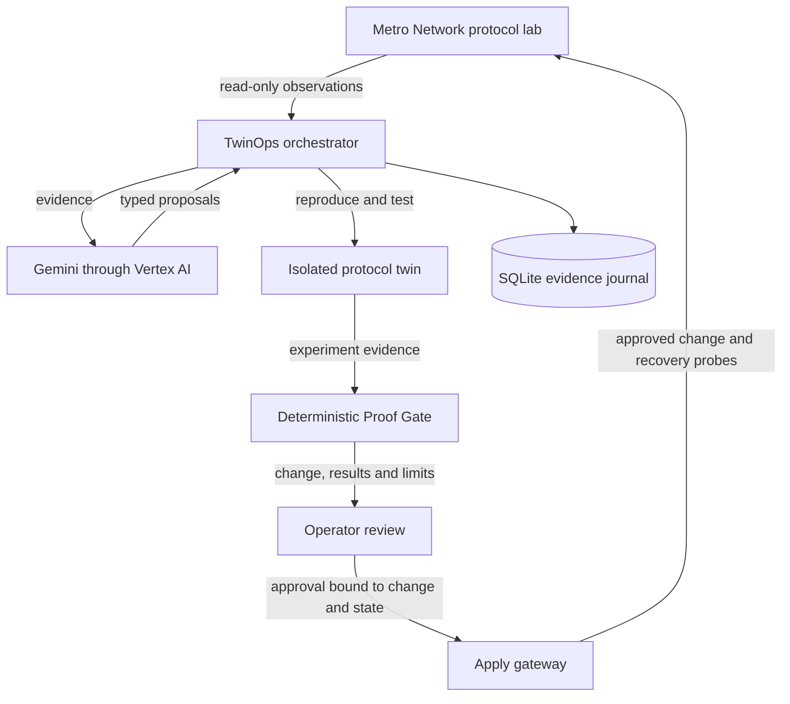

# TwinOps technical guide

TwinOps investigates a network incident, rehearses candidate repairs in an isolated twin, and presents the tested change for approval. Metro Network owns the connected application lab; TwinOps reads its observations through an authenticated connector and writes through an approval-bound apply gateway.

Use the [project README](../README.md) for setup and detailed operating commands, the [demo walkthrough](JUDGE_GUIDE.md) to inspect the hosted application, and the [submission overview](SUBMISSION.md) for the problem and intended impact.

## Architecture



The hosted connected demo runs on Cloud Run with two isolated Linux network namespace lab networks. Local connected development uses Containerlab and Docker. Both protocol-lab paths exercise FRR routing, CoreDNS and nginx. The deterministic model twin and in-browser engine are separate run modes.

The model returns structured proposals and explanations. It cannot execute shell commands, change verification policy, compute its own authoritative verdict or authorize a network write. Schema checks and the typed action catalogue sit between model output and execution.

## Source map

| Location | Responsibility |
|---|---|
| [frontend/src/workbench/](../frontend/src/workbench/) | Investigation, decision review and evidence interface |
| [local-app/](../local-app/) | Metro Network web interface |
| [api.py](../backend/twinops/api.py) | REST API, server-sent events and static frontend serving |
| [orchestrator.py](../backend/twinops/orchestrator.py) | Investigation pipeline and candidate selection |
| [planner/](../backend/twinops/planner/) | Model and runbook planners, provider integration and evidence-based explanations |
| [twin.py](../backend/twinops/twin.py) and [lab/](../backend/twinops/lab/) | Reproduction, experiments, challenges and gate evaluation |
| [catalogue.py](../backend/twinops/catalogue.py) | Typed actions and execution policy |
| [approvals.py](../backend/twinops/approvals.py) and [service.py](../backend/twinops/service.py) | Signed approval binding, lifecycle, expiry and apply coordination |
| [network_app.py](../backend/twinops/network_app.py) and [network_connector.py](../backend/twinops/network_connector.py) | Application-lab ownership and authenticated connection |
| [store.py](../backend/twinops/store.py) and [proofpack.py](../backend/twinops/proofpack.py) | Evidence persistence and Proof Pack export |
| [deploy/](../deploy/) | Connected Cloud Run deployment and local pilot configuration |

## Investigation flow

1. Metro measures service journeys and reports a failure. TwinOps polls the connector; the selected exercise fault is withheld from the planner.
2. TwinOps captures observations and state hashes. Bounded, allow-listed read-only diagnostics support hypothesis ranking.
3. Graph-derived coverage selects the affected network slice. The separate twin must reproduce the observed failure with adequate coverage.
4. Candidate changes run against the faulty twin state. Tests inspect restoration, unaffected journeys, negative controls, additional challenges and rollback.
5. Failed checks can guide bounded revisions. Revised and recalled historical repairs are tested again as candidates.
6. Decision review presents the exact diff, coverage, warnings and untested conditions. Approval binds the tested change and target-state hashes.
7. The gateway rechecks authorization, freshness and target drift, then applies the change. Multiple observation windows verify recovery; failed checks trigger a rollback attempt and verification.

The [recorded routing repair](evidence/recorded-demo.json) demonstrates why additional tests matter: a broad rollback restores initial connections but fails Hamburg's IPv6 challenge. The selected Gemini proposal instead removes one blocking rule.

## Proof Gate

| Gate | Evidence required |
|---|---|
| G1 | Observed fault reproduced in the twin |
| G2 | Affected journeys restored by the candidate |
| G3 | Unaffected journeys and negative/control probes preserved |
| G4 | Required challenge evidence present, with no hard challenge failure |
| G5 | Schema-valid, allowed actions within the blast-radius policy |
| G6 | Rollback rehearsed and captured twin state restored |
| G7 | Latency and soft checks evaluated; warnings visible |
| G8 | Authorized approval bound to the tested change |

A passing technical result is **PASS UNDER DEFINED TESTS**, with warnings where applicable. Session-continuity checks can be model-derived; they do not establish measured production session survival. Immutable candidate evidence can retain G8 as pending while the separate approval and applied outcome record the completed decision.

Approval is signed and expires. The gateway rehashes the proposed change and checks the connected target state before writing. Archived investigations cannot authorize new changes. If an apply is interrupted or rollback cannot be verified, the lab requires operator recovery.

## Run locally

Requirements: Python 3.12+, Node.js 23.6+ and Docker Desktop for the connected protocol lab. On a fresh checkout:

```sh
python3 -m venv .venv
.venv/bin/pip install -e 'backend[dev]'
npm --prefix frontend ci
```

Copy [`.env.example`](../.env.example) to `.env` for the first setup and configure the desired planner. Start Docker Desktop, then run:

```sh
npm run dev:connected
```

Metro opens at `http://localhost:8010`; TwinOps opens at `http://localhost:5173/connections`, with its API on port 8000. The first run builds the local lab. The [README quick start](../README.md#quick-start) covers configuration, fault controls and recovery behavior.

`npm run dev` starts the self-contained backend/frontend path; the model twin is the default. Without a reachable backend, the UI uses its deterministic browser engine. Runtime details and the AI trace identify the active path and any planner fallback.

`npm run dev:stop` stops the applications and retains evidence. Preserve `backend/.data/connected/` and `local-app/.data/` when inspecting an interrupted connected run; reset and recovery must follow the application lifecycle.

## Configure Google AI and deployment

The hosted demonstration used Gemini 2.5 Flash through Vertex AI. Equivalent provider selection uses these environment settings with authorized Google Cloud credentials:

```dotenv
TWINOPS_LLM_PROVIDER=vertex
TWINOPS_LLM_MODEL=gemini-2.5-flash
GOOGLE_GENAI_USE_VERTEXAI=true
GOOGLE_CLOUD_PROJECT=your-project-id
GOOGLE_CLOUD_LOCATION=europe-west1
```

Local Gemini API-key mode also supports `GEMINI_API_KEY_FILE`; the key stays in an ignored file. Full options are documented in [`.env.example`](../.env.example), [config.py](../backend/twinops/config.py) and the [README](../README.md#google-cloud-and-ai).

The [connected deployment script](../deploy/cloudrun-lab.sh), [Dockerfile](../deploy/cloudrun-lab.Dockerfile) and [Cloud Run entrypoint](../backend/twinops/cloudrun.py) define the hosted runtime. Provision the project, required APIs, runtime service account and operator secret as described in the deployment scripts. The connected deployment uses one Cloud Run instance for the shared lab, Vertex AI for reasoning, Secret Manager for the approval credential, and Cloud Build/Artifact Registry for the image.

## API and evidence

| Endpoint | Purpose |
|---|---|
| `GET /api/health` and `GET /api/config` | Service health and configured runtime |
| `GET /api/connections` | Connected application status |
| `GET /api/incidents` | Saved investigations |
| `GET /api/incidents/{id}` | Observations, candidates, approval and outcome |
| `GET /api/incidents/{id}/events` | Resumable server-sent event stream |
| `POST /api/incidents/{id}/decision` | Protected approve/reject decision |
| `GET /api/incidents/{id}/proof-pack?format=json` | Download the decision evidence; HTML is also supported |
| `GET /api/docs` | Generated API documentation |

SQLite journals evidence before events are published. A Proof Pack includes observations, reproduction, candidate diffs, challenges, gates, approval, outcome and untested conditions. AI trace records distinguish actual calls, discarded output, replay and runbook fallbacks. A configured model badge alone does not prove a model invocation.

Two public records retain the verification scope:

- [Hosted recorded demo](evidence/recorded-demo.json): ten actual Vertex/Gemini calls, zero fallbacks, zero diagnosis writes, a model-proposed selected change, owner-authorized approval and eleven passing checks in each of three post-change windows.
- [Foundation evaluation](evidence/foundation-evaluation.json): 320 deterministic model cases with 200 repairs, 120 expected abstentions and zero unsafe passes. These are separate runbook/model results with zero model calls.

## Limits and next work

This is a shared prototype using synthetic topology, incidents and customer counts with real protocol services. The recorded approval was executed by browser automation on the owner's explicit instruction. The demo establishes a measured lab result, not production reliability or operator time savings.

Cloud Run instance-local history can disappear when the instance is replaced. SQLite persistence on an unchanged disk does not provide cloud durability. Shared role credentials are not individual enterprise identity. Increased probe concurrency is not a production load test; physical-layer behavior and routing convergence timing remain outside the recorded verification.

Production adoption requires durable storage and coordination, individual identity and authorization, per-target isolation, validated network adapters, monitoring and tested operational recovery. An operator study and read-only shadow pilot would establish whether the workflow improves review effort before broader deployment.
